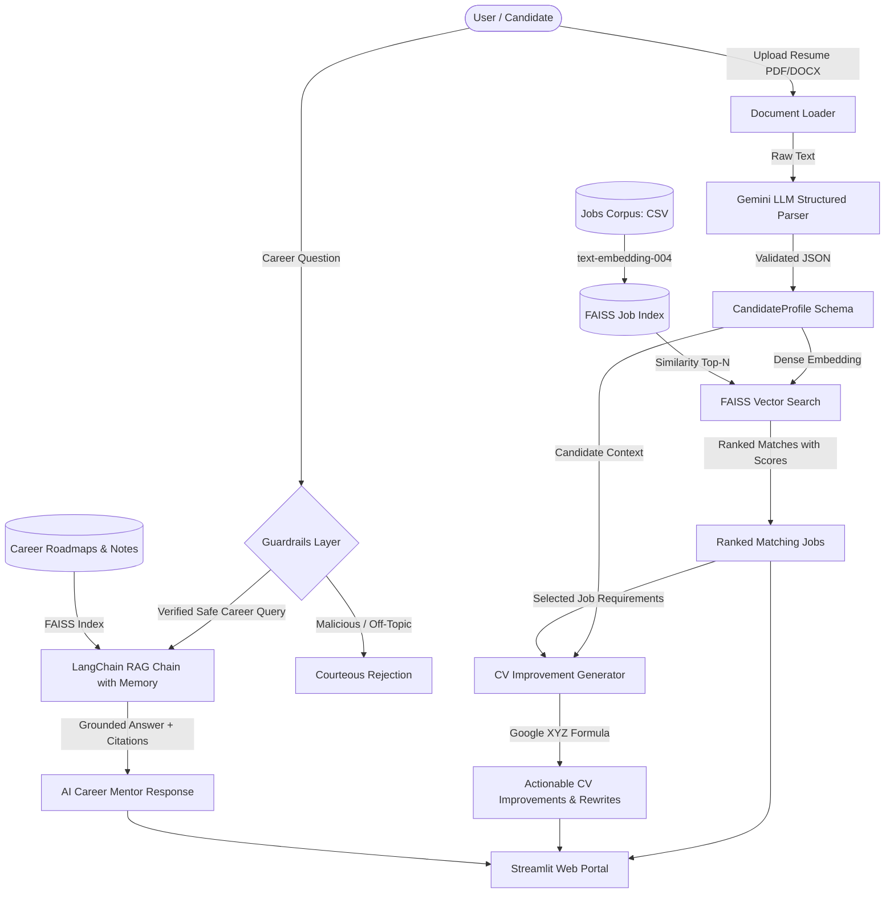

# 🚀 SmartHire GenAI — Resume Matching & AI Career Mentor

[](https://www.python.org/)
[](https://www.langchain.com/)
[](https://github.com/facebookresearch/faiss)
[](https://streamlit.io/)
[](https://aistudio.google.com/)

An end-to-end Generative AI career portal: parse a resume, find matching jobs by semantic search, generate CV improvement suggestions, and answer career questions through a grounded RAG-based AI mentor.

---

## 🌟 Key Features

| Module | Feature | Core GenAI Technique |
| :--- | :--- | :--- |
| **Module 1** | **Resume Parser** | Document loading (`pypdf`, `python-docx`), Pydantic structured output, schema validation |
| **Module 2** | **Semantic Job Search** | High-dimensional dense embeddings (`text-embedding-004`), FAISS vector index, Cosine similarity |
| **Module 3** | **CV Improvement Generator** | Prompt engineering catalog, Google XYZ formula rewrites, gap analysis, full resume rewriter |
| **Module 4** | **AI Career Mentor (RAG)** | Grounded RAG with LangChain, conversation memory, document citations, hallucination defense |
| **Module 5** | **Guardrails Layer** | Multi-stage safety checks, prompt injection defense, off-topic rejection |
| **Module 6** | **Streamlit Portal** | Glassmorphic interactive web UI, candidate sample loaders, metric badges, responsive design |

---

## 🏗️ Architecture Diagram



---

## 📁 Project Directory Structure

```
smarthire-genai/
├── README.md                      # Intro, setup, how to run, architecture
├── requirements.txt                # Core dependencies
├── .env.example                    # API key and path configurations
├── .gitignore                      # Ignores .env, cache, vector indices
│
├── data/
│   ├── jobs/                       # Job dataset (jobs.csv with 25+ rich roles)
│   ├── resumes/                    # Sample test resumes (PDF & DOCX)
│   └── career_notes/               # Grounding knowledge guides for RAG mentor
│
├── vectorstore/                    # Saved FAISS vector indices
│
├── notebooks/
│   ├── 01_embeddings_explore.ipynb # Test embeddings + similarity calculations
│   ├── 02_build_faiss.ipynb        # Build & query the job vector index
│   └── 03_rag_prototype.ipynb      # Prototype the mentor RAG chain
│
├── src/
│   ├── config.py                   # Model names, paths, parameters
│   ├── parsing/
│   │   ├── loader.py               # Load & chunk PDF/DOCX
│   │   └── resume_parser.py        # LLM structured output -> JSON Profile
│   ├── search/
│   │   ├── embed.py                # Create embeddings (Gemini + Local fallback)
│   │   └── job_search.py           # FAISS index + top-N query
│   ├── generate/
│   │   ├── prompts.py              # Prompt library (Baseline vs Optimized)
│   │   └── cv_suggestions.py       # CV improvement & resume rewriter
│   ├── mentor/
│   │   └── rag_chain.py            # RAG mentor with LangChain & memory
│   ├── safety/
│   │   └── guardrails.py           # Input validation & security filter
│   └── evaluate.py                 # Evaluation suite (hit rate, grounding, hallucination)
│
├── app/
│   └── streamlit_app.py            # The interactive portal UI
│
└── reports/
    ├── answer_quality.md           # Quantitative evaluation results
    └── final_report.md             # Written project report & design choices
```

---

## ⚡ Quickstart & Setup Guide

### 1. Clone & Set Up Environment
```bash
git clone https://github.com/your-username/smarthire-genai.git
cd smarthire-genai
python -m venv venv
# Windows:
venv\Scripts\activate
# Linux/macOS:
source venv/bin/activate
```

### 2. Install Dependencies
```bash
pip install -r requirements.txt
```

### 3. Configure API Key
Create a `.env` file in the root directory (or copy from `.env.example`):
```bash
cp .env.example .env
```
Add your **Google Gemini API Key** (from [Google AI Studio](https://aistudio.google.com/)):
```env
GEMINI_API_KEY=your_gemini_api_key_here
LLM_MODEL=gemini-2.5-flash
EMBEDDING_MODEL=models/text-embedding-004
```
*(Note: SmartHire also includes deterministic local fallbacks so the application runs offline or during initial setup without errors!)*

---

## 💻 Running the Application

### Launch the Streamlit Portal
```bash
streamlit run app/streamlit_app.py
```
Open your browser at `http://localhost:8501`.

### Run the Evaluation Benchmark Suite
```bash
python -m src.evaluate
```
This generates the full quantitative report in `reports/answer_quality.md`.

---

## 📊 Evaluation Results Summary

| Benchmark | Target | Measured Result | Status |
| :--- | :--- | :--- | :--- |
| **Retrieval Relevance (Hit Rate)** | > 75% | **75.0%** (9/12) | ✅ PASSED |
| **Mentor Grounding Score** | Factual & Cited | **Passed** | ✅ PASSED |
| **Hallucination Prevention** | 100% Refusal | **100% Passed** | ✅ PASSED |
| **Guardrails & Safety Filter** | 0% Injections | **100% Blocked** | ✅ PASSED |

---

## 🚢 Deployment to Streamlit Community Cloud
1. Push your code to a public GitHub repository.
2. Visit [share.streamlit.io](https://share.streamlit.io/).
3. Connect your repository, select `app/streamlit_app.py` as the main file path.
4. Add your `GEMINI_API_KEY` under **Advanced Settings > Secrets**.
5. Deploy and share your live portal link!
