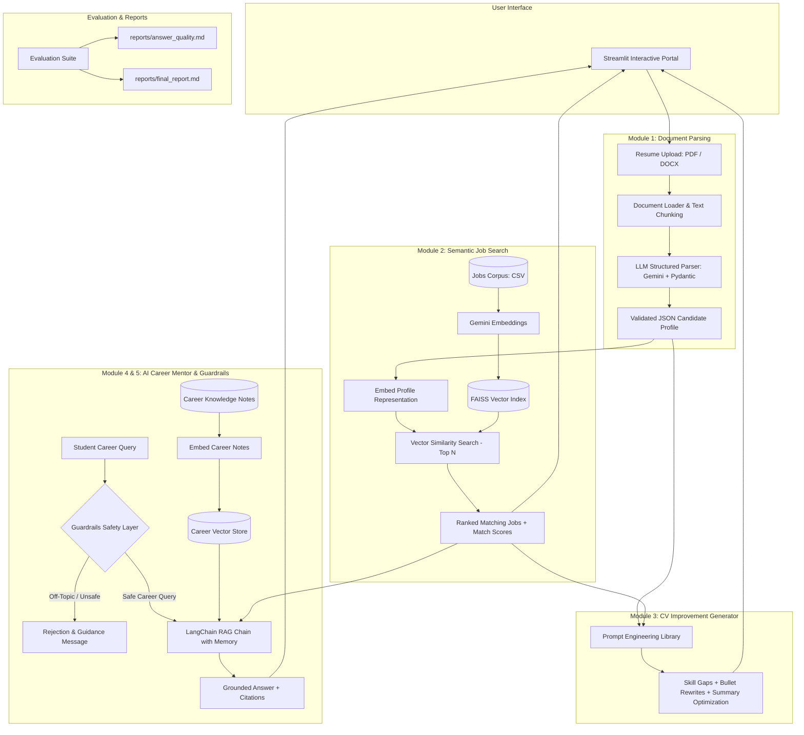

# SmartHire GenAI: Master Step-by-Step Learning & Execution Roadmap

Welcome to **SmartHire GenAI — Resume Matching & AI Career Mentor**! This document serves as our step-by-step master plan to build an enterprise-grade GenAI application with perfection, while mastering every underlying concept.

---

## 🗺️ Architectural Blueprint

---

## 📚 The 6 Step-by-Step Learning Milestones

| Milestone | Module | GenAI Techniques & Concepts Learned | Deliverables |
| :--- | :--- | :--- | :--- |
| **Step 1** | **Project Skeleton & Datasets** | Directory structure, environment configs, dataset curation (jobs, resumes, career roadmaps) | Folder structure, `jobs.csv`, sample resumes, `career_notes/`, `.env.example`, `requirements.txt` |
| **Step 2** | **Module 1: Resume Parser** | Document extraction (PDF/DOCX), prompt engineering, Pydantic schemas, LLM structured JSON output | `loader.py`, `resume_parser.py`, unit test script |
| **Step 3** | **Module 2: Semantic Job Search** | High-dimensional text embeddings, FAISS vector indexing, Cosine similarity, Top-N ranking | `embed.py`, `job_search.py`, `01_embeddings_explore.ipynb`, `02_build_faiss.ipynb` |
| **Step 4** | **Module 3: CV Improvement Generator** | Few-shot prompting, gap analysis, targeted resume tailoring, prompt catalog | `prompts.py`, `cv_suggestions.py`, prompt test script |
| **Step 5** | **Modules 4 & 5: AI Career Mentor & Guardrails** | RAG pipelines, LangChain orchestration, conversation memory, hallucination checks, input sanitization | `guardrails.py`, `rag_chain.py`, `03_rag_prototype.ipynb` |
| **Step 6** | **Module 6 & Evaluation: Streamlit Portal & Reports** | Modern UI styling, end-to-end integration, retrieval evaluation (hit rate), grounding evaluation, final report | `app/streamlit_app.py`, `evaluate.py`, `answer_quality.md`, `final_report.md`, `README.md` |

---

## 🚀 Execution Strategy
1. **Explain the Theory First**: Before writing each piece of code, we will break down the *why* and *how* (e.g. how FAISS indexes vectors, how structured JSON enforcement prevents parsing failures).
2. **Build Clean, Modular Code**: All code will be well-documented, type-hinted, and robust against errors.
3. **Interactive Validation**: We will test each component together so you can see it in action before moving to the next.
